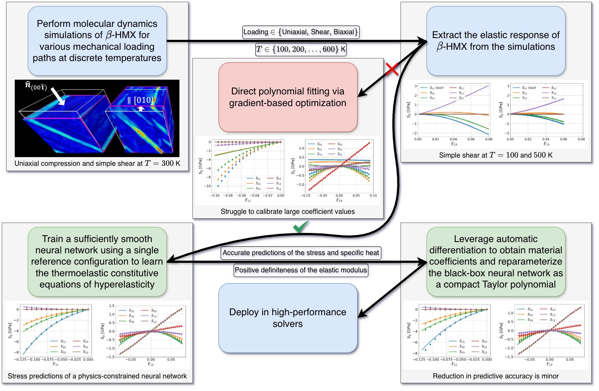

# Higher-order elastic and thermal stress coefficients of $\beta$-HMX for high-fidelity continuum models: A neural network guide to calibrating thermoelasticity data from molecular dynamics

## Graphical abstract

<p align='center'></p>

Workflow from data collection to calibration of material coefficients via Taylor expansion of a neural network model.

## Citation

Please cite our [paper](https://onlinelibrary.wiley.com/doi/10.1002/prep.70087) if you find this code useful:

```bibtex
@article{phan2025higher,
    title={Higher-order elastic and thermal stress coefficients of $\beta$-HMX for high-fidelity continuum models: A neural network guide to calibrating thermoelasticity data from molecular dynamics},
    author={Phan, Nhon N and Sewell, Tommy and Clayton, John D and Sun, WaiChing},
    journal={Propellants, Explosives, Pyrotechnics},
    page={e70087},
    year={2025},
    publisher={Wiley Online Library}
}
```
